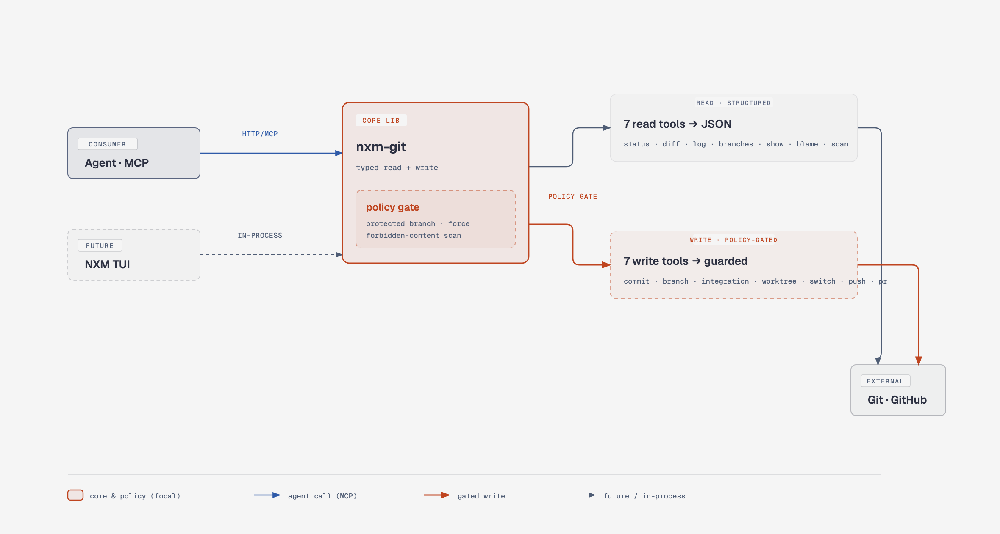

<div align="center">

# Nxm-git

<!-- Licensed MIT OR Apache-2.0 — same as the rest of the nxm tooling. -->
[](https://github.com/dangranaz/nxm-mcp-git/actions/workflows/ci.yml)
[](#license)
[](https://www.rust-lang.org)
[](#running-the-server)
[](#the-14-tools)
[](#verifying-the-install)
[](CHANGELOG.md)

**Typed, policy-gated Git for AI agents — structured JSON in, guard-railed writes out.**

`#Rust` · `#MCP` · `#AIagents` · `#Git` · `#SoftwareGovernance` · `#SecureByDesign` · `#LocalFirst` · `#DeveloperTools`

<br>



</div>

Stop letting an agent shell out to `git` and parse text it half-understands.
`nxm-git` gives an agent the Git operations it actually needs as **14 typed MCP
tools** that return structured JSON, with the dangerous edges — force-push,
protected branches, leaking private content — closed by a policy the agent
doesn't get to vote on.

- **Repo:** `dangranaz/nxm-mcp-git`
- **Transport:** MCP Streamable HTTP on `127.0.0.1:7281` (route `/mcp`), or stdio
- **Also:** the Git backend of the future NXM TUI — one core library, two consumers

---

## Scope — why I built it

AI coding agents are fast. Left alone with a shell, they are also **confidently
destructive**: they force-push over a colleague's work, commit straight to
`main`, or push a branch that still carries a private token or an internal-only
marker — all while the command "looked right."

The usual fix is a wall of shell wrappers and pre-commit hooks, bolted on per
machine, invisible to the agent and impossible to reason about. I wanted the
opposite: the safety to live **inside the Git layer itself**, expressed as data,
inherited identically by every caller.

So `nxm-git` is built on three convictions:

1. **Structured beats scraped.** An agent should receive `git_diff` as
   per-file additions/deletions, not a wall of unified-diff text it has to
   re-parse and occasionally misread. Typed JSON in, typed JSON out.
2. **Guards are friction, not a cage.** The policy stops the *distracted
   mistake* — a force-push nobody meant, a commit on a protected branch, a push
   carrying forbidden content. A *deliberate* operation still passes, with an
   explicit flag. The human (or the agent, after asking) opts in on purpose.
3. **One core, many consumers.** The same safety that protects an agent over
   MCP must protect the TUI calling the library in-process. Guards that live in
   the core can't be forgotten by a new caller.

This is the tool incarnation of a governance layer: the rules an agent obeys are
written down once, in code, and apply to human and machine alike.

## What you get — the value in one screen

| If you want to… | nxm-git gives you… |
|---|---|
| Give an agent Git without a raw shell | 14 typed tools returning JSON, not text to parse |
| Stop accidental force-push / commits to `main` | A per-repo policy that refuses them unless explicitly confirmed |
| Never leak private content to a public mirror | `git_scan_forbidden` — a pre-push gate that blocks forbidden patterns |
| Run parallel agents without trashing each other's work | Integration branches + isolated worktrees, created mechanically |
| Share one safe Git backend between an agent and a UI | One Rust core library; MCP server and TUI both call it |

## The dual model

Two crates, one core — the same shape as nxm-decision and nxm-memory:

| Crate | Role |
|---|---|
| `nxm-git` | Core library. Typed read/write Git, policy enforcement, forbidden-content scan. No MCP knowledge. |
| `nxm-git-mcp` | Thin MCP server over the core. Wires tools, transport and config. Adds no Git logic. |

Two consumers, one core:

- **Agent** — via MCP. Fourteen typed tools, shared by every client through a
  single long-running HTTP process.
- **TUI** (future) — in-process, Rust. Calls the core lib directly and inherits
  the same guards for free; the human confirms risky operations in the UI.

The core never knows who called it. Guards are expressed as explicit flags
(`confirm`, `allow_force`) that the *consumer* supplies — an agent must ask the
user, the TUI sets them after a dialog.

## The 14 tools

### Read — structured, native (no output parsing)

| Tool | What it returns |
|---|---|
| `git_status` | Staged, unstaged and untracked paths. |
| `git_diff` | Per-file and total additions/deletions, between refs or worktree vs index. |
| `git_log` | Commits in a range: SHA, author, email, date, subject. Honours `range` and `limit`, newest-first. |
| `git_branches` | Local and remote branches with ahead/behind vs upstream. |
| `git_show` | File contents at a ref, or commit info when `path` is omitted. |
| `git_blame` | Per-line commit, author and content, including uncommitted worktree lines. |
| `git_scan_forbidden` | Forbidden-pattern scan of a ref or worktree — hits or `CLEAN`. |

### Write — policy-gated

| Tool | What it does |
|---|---|
| `git_commit` | Commits staged changes. Refuses on a protected branch unless `confirm=true`. |
| `git_create_branch` | Creates a branch without switching to it, rooted at an explicit `base` (default: the policy's develop branch, never the current HEAD). Policy-checked. |
| `git_create_integration_branch` | Creates `integration/<workstream>` from an explicit base (default develop); validates the name against the configured integration branches. Step one of the worktree convention. |
| `git_worktree_add` | Adds the workstream's isolated worktree (default `.worktrees/<workstream>` on `integration/<workstream>`). Refuses if the branch is missing, the path exists, or the path is outside `.worktrees/`. Step two of the worktree convention. |
| `git_switch` | Switches the worktree to an existing branch. Policy-checked. |
| `git_push` | Pushes the current branch. Refuses protected targets, force without `allow_force` + `confirm`, and any push carrying forbidden content. |
| `git_pr_create` | Opens a PR via `gh pr create` and returns its URL. Never merges. |

`git_scan_forbidden` is the flagship tool: the public-safety check that was
otherwise done by hand, every session, before publishing.

Tools are **neutral and deterministic** — same input, same behaviour. Irreversible
operations are never silent: no auto-merge, no unflagged force-push.

## Configuration

### Server config — `~/.nxm/git-mcp.toml`

The safety perimeter. The server refuses to touch any repository outside
`allowed_roots`. A missing file means an **empty** allow-list: every tool call
fails until you configure it.

```toml
allowed_roots = [
  "/Users/devdaniele/Projects/private",
]
```

Paths are canonicalized before comparison, so `..` segments and symlinks cannot
escape the roots.

### Per-repo policy — `.nxm-git-policy.toml`

Committed inside each target repository, orthogonal to `allowed_roots`. Applied
by the core library, so both the agent and the TUI inherit it.

```toml
protected_branches = ["main", "master"]
allow_force = false
destructive_confirm = true
forbidden_patterns = [".*PRIVATE.*", ".*internal-only.*"]
require_pre_push = []
```

Defaults when the file is absent: `protected_branches = ["main"]`,
`allow_force = false`, `destructive_confirm = true`, and `forbidden_patterns`
defaulting to the built-in `FORBIDDEN_PATTERNS` list. A malformed file, or one
with an unknown key, is a **load error** — a typo must never silently unprotect
a branch.

### Policy semantics

| Guard | Effect |
|---|---|
| Protected branch | Commit / push / PR against it requires `confirm=true`. |
| `allow_force` | Must be enabled in policy *and* per call, plus `confirm`. |
| Forbidden content | `git_push` is refused if the scan finds hits. |
| `require_pre_push` | Listed commands must succeed before a push is allowed. |

The guards are **friction, not a cage**. They prevent the distracted mistake, not
the deliberate act: an intentional operation passes with an explicit flag. This
complements — and does not replace — a shell-level hook that blocks dangerous
Git commands before they ever run.

## Installation

The installer builds from this checkout and wires everything up:

```bash
./install.sh
```

It is idempotent and does, in order:

1. **Builds** the release binary (`cargo build --release --workspace`).
2. **Installs** it to `~/.local/bin/nxm_git_mcp`.
3. **Seeds** the server config `~/.nxm/git-mcp.toml` if missing (safety
   perimeter — see [Configuration](#configuration)); an existing config is left
   untouched.
4. **Registers** nxm-git as an MCP server on every supported client found on the
   machine (Kiro CLI, Pi, OpenCode), backing up each config before editing.

Overrides:

| Env var | Default | Effect |
|---|---|---|
| `NXM_GIT_BIN_DIR` | `$HOME/.local/bin` | Where the binary is installed. |
| `NXM_GIT_ALLOWED_ROOT` | `$HOME/Projects/private` | `allowed_roots` entry when seeding the config. |

Registering clients requires [`jq`](https://jqlang.github.io/jq/); without it the
installer tells you to add the entry by hand.

After installing, start the server (next section) and verify with
[Verifying the install](#verifying-the-install).

## Running the server

```bash
# build once
cargo build --release --workspace

# start (idempotent, stays up until stopped or reboot)
./scripts/git-up.sh

# stop
./scripts/git-down.sh
```

`git-up.sh` serves MCP **Streamable HTTP** on **`127.0.0.1:7281`**, route
**`/mcp`**, stateless (`stateful_mode=false`) — one shared process for all
clients. It is idempotent, takes an atomic start-lock to survive concurrent
invocations, and waits up to 10s for the port to bind.

- PID file: `~/.nxm/git-mcp.pid`
- Log: `~/.nxm/git-mcp.log`

The binary also runs over **stdio** when no address is given. `--http <ADDR>`
wins over the `NXM_GIT_MCP_HTTP_ADDR` env var; unset means stdio.

Port **:7281** is nxm-git's own — it does not collide with nxm-decision on
:7280 or nxm-memory on :7175.

## Registering as an MCP client

Add nxm-git to each client that talks to your agents.

**OpenCode** — `~/.config/opencode/opencode.jsonc`:

```jsonc
"mcp": {
  "nxm-git": {
    "type": "remote",
    "url": "http://127.0.0.1:7281/mcp"
  }
}
```

> Use `opencode.jsonc` under the `mcp` key — the official v2 location. Do **not**
> use the legacy top-level `~/.config/opencode/mcp.json`: keeping two sources
> risks a stale one silently winning after an opencode upgrade.

**Codex** — `~/.codex/config.toml`:

```toml
[mcp_servers.nxm-git]
url = "http://127.0.0.1:7281/mcp"
```

**Kiro CLI** — `~/.kiro/settings/mcp.json`:

```json
"nxm-git": { "url": "http://127.0.0.1:7281/mcp", "timeout": 60000 }
```

**Pi** — `~/.pi/agent/mcp.json`:

```json
"nxm-git": { "url": "http://127.0.0.1:7281/mcp" }
```

**Dashboard** — `~/.local/bin/nxm-mcp` lists and manages the local servers:

```bash
nxm-mcp status   # shows nxm-git among the servers
nxm-mcp up       # starts the HTTP servers it manages
nxm-mcp down     # stops them
```

## Verifying the install

```bash
cargo build --release --workspace
./scripts/git-up.sh

curl -s -X POST http://127.0.0.1:7281/mcp \
  -H 'Content-Type: application/json' \
  -H 'Accept: application/json, text/event-stream' \
  -d '{"jsonrpc":"2.0","id":1,"method":"tools/list","params":{}}' \
  | grep -o '"name":"git_[a-z_]*"' | sort -u
# → 14 tools

nxm-mcp status | grep nxm-git
./scripts/git-down.sh
```

## The workflow it guards

nxm-git exists to make one branching pipeline **mechanical** instead of
hand-driven: `main` only ever receives `--no-ff` merges from `develop`; features
and workstreams land through integration branches in isolated worktrees; the
dangerous edges are refused unless explicitly confirmed. The full convention —
and exactly how each policy field enforces it — lives in
[`WORKFLOW.md`](WORKFLOW.md).

## Roadmap

Where nxm-git is headed. Order is indicative, not a promise — issues and PRs can
reshuffle it.

| Stage | Item | Status |
|---|---|---|
| **0.2.x** | 14 typed tools, per-repo policy, forbidden-content scan, workstream worktrees | ✅ shipped |
| **0.3** | `git_merge` / `git_rebase` as policy-gated tools (today merges are still manual shell) | 🔜 planned |
| **0.3** | Richer `git_log` filters (by author, path, grep) and paginated history | 🔜 planned |
| **0.4** | NXM TUI consuming the core in-process — the second consumer, with UI confirmation dialogs | 🧭 designed |
| **0.4** | Structured conflict reporting for `git_merge` (typed hunks, not raw markers) | 🧭 designed |
| **0.5** | Policy presets (`strict` / `team` / `solo`) shippable as a single key | 💡 idea |
| **0.5** | Per-crate release tags for multi-crate workspaces (see `WORKFLOW.md` open point) | 💡 idea |
| **future** | Pluggable forbidden-pattern packs; audit log of every gated decision | 💡 idea |

Have an idea or a need that isn't here? Open an issue — the roadmap is meant to
move. See [Contributing](#contributing).

## Non-goals

- Not a full Git port — only the operations agents and the TUI actually perform.
- No auto-merge, no silent force-push.
- Does not replace a shell-blocking hook; it complements it.
- No guarantee of security. The value is ergonomics, portability and guard-rails.

## Layout

```
nxm_git/       core library: status, diff, log, branches, show, blame,
               scan, policy, write, pr, config, resolve, worktree
nxm_git_mcp/   MCP server: tool router (14 tools), HTTP transport, binary
scripts/       git-up.sh / git-down.sh
install.sh     build-from-source installer (binary + config + client registration)
WORKFLOW.md    the branching pipeline nxm-git mechanically guards
CHANGELOG.md   per-release history (Conventional Commits)
```

## Contributing

Contributions are welcome — nxm-git is small on purpose, and that makes it easy
to improve.

- **Fork it and make it better.** Found a rough edge, a missing Git operation, a
  bug? Fork the repo, do the change, and open a pull request. Small, focused PRs
  (one logical change each) are the easiest to review and merge.
- **Open an issue first for anything larger** — a new tool, a policy field, a
  behaviour change — so we can agree on the shape before you write the code.
- **Respect the guard-rails.** The project dogfoods its own policy: one logical
  change per commit, Conventional Commits, and the forbidden-content scan must
  pass. See [`WORKFLOW.md`](WORKFLOW.md) for the branching pipeline.
- **New ideas are explicitly wanted.** The [Roadmap](#roadmap) is a starting
  point, not a wall — propose what you'd find useful.

If nxm-git saves you from one accidental force-push, a ⭐ on the repo helps
others find it.

## Contributors

Built and maintained by:

- [**@dangranaz**](https://github.com/dangranaz)
- [**@draco690456**](https://github.com/draco690456)

[](#contributors)

Want to see your name here? [Contributing](#contributing) tells you how.

## License

Open source, licensed under either of

- MIT license ([LICENSE-MIT](LICENSE-MIT))
- Apache License 2.0 ([LICENSE-APACHE](LICENSE-APACHE))

at your option. Unless you explicitly state otherwise, any contribution you
intentionally submit for inclusion in the work, as defined in the Apache-2.0
license, shall be dual-licensed as above, without any additional terms or
conditions.
